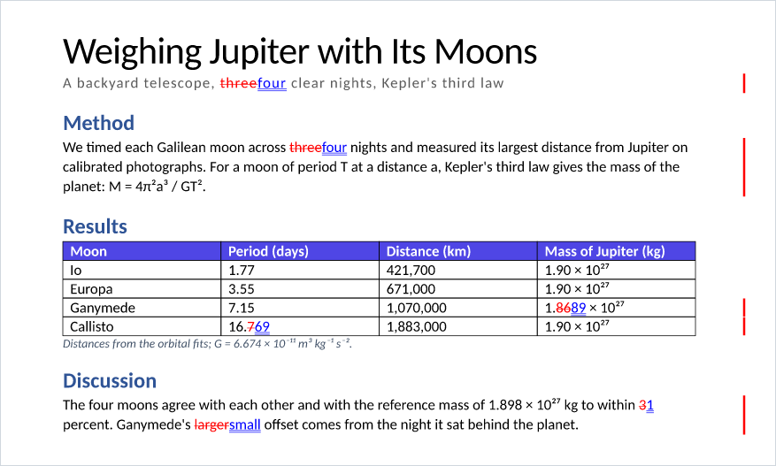
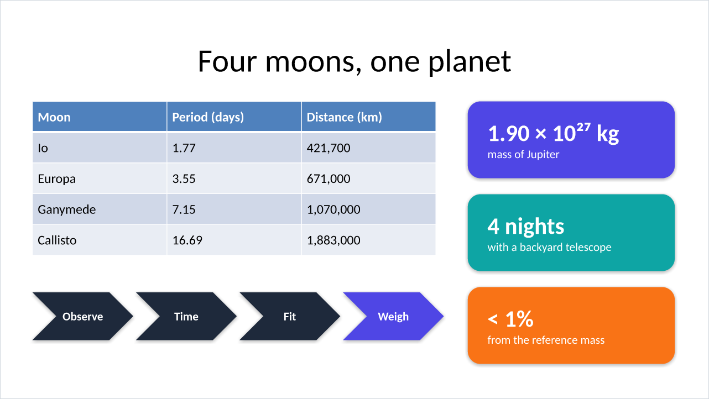

<div align="center">


# oxoffice-skills

**Word and PowerPoint skills for AI agents: read, write, edit, review and render `.docx` and `.pptx` files with
[oxoffice](https://github.com/oxoffice-dev/oxoffice).**

[](LICENSE)
[](#-install)
[](https://github.com/oxoffice-dev/oxoffice)
[](plugin/skills/)

</div>

|  |  |
|:---:|:---:|
| 📝 A redline of two versions of a report, in reviewer colours | 📊 A slide built and rendered from code |

<p align="center"><sub>Both pictures come straight out of oxoffice: no Word, no PowerPoint, no LibreOffice.</sub></p>

Give your agent real Office skills. This plugin teaches it to work on Word and PowerPoint files through the
`oxoffice` command line and the `oxoffice` Python package, instead of LibreOffice round trips, python-docx,
python-pptx or hand-written XML.

## ✨ Why oxoffice-skills

- ⚡ **Native and fast**: one `oxoffice` call for whole-file work, the Python package for anything finer. No office
  suite to install.
- 🎯 **Loads by itself**: the skills step in as soon as a `.docx` or `.pptx` shows up, even when you don't name a
  tool.
- ✍️ **Safe edits**: counted find and replace across runs, text edited without losing its formatting, and the input
  never written over.
- 🔍 **Real tracked changes**: list, accept and reject revisions, and build a redline of two versions.
- 📌 **One pinned release**: the skills are written and checked for one oxoffice release, and run that one, never
  whatever happens to be installed.
- 🧪 **Examples that run**: every example of the skills runs on each push to oxoffice's `main`, against the build
  of that commit.
- 🩹 **Honest about gaps**: `oxoffice limitations` lists what the build cannot do yet, each with a workaround, and
  the skills hand that one step to the built-in skills.

## 🚀 Install

In Claude Code:

```
/plugin marketplace add oxoffice-dev/oxoffice-skills
/plugin install oxoffice@oxoffice-skills
```

Nothing else to set up. The skills are written for **oxoffice 0.1.0** and look for it in this order: an
`oxoffice` 0.1.0 already installed, then `uvx` / `uv run --with oxoffice==0.1.0`, a virtual environment of its
own with `pip`, `pixi exec` from prefix.dev, and the release's installer for the command alone. Without any of
them, they fall back to the built-in Word and PowerPoint skills.

oxoffice itself is also available on its own, for use outside the skills:

| Channel | Command |
| --- | --- |
| 🐍 PyPI | `pip install oxoffice`, `uv add oxoffice` or `uv tool install oxoffice` |
| 🟢 conda | `pixi global install -c https://prefix.dev/hadim/oxoffice -c conda-forge oxoffice` |
| 🐚 Shell installer | `curl -fsSL https://github.com/oxoffice-dev/oxoffice/releases/latest/download/install.sh \| sh` |
| 🪟 Windows installer | `powershell -ExecutionPolicy Bypass -c "irm https://github.com/oxoffice-dev/oxoffice/releases/latest/download/install.ps1 \| iex"` |
| 📦 GitHub release | the [releases page](https://github.com/oxoffice-dev/oxoffice/releases), with checksums and a signed build provenance |

Details in [`plugin/skills/docx/references/install.md`](plugin/skills/docx/references/install.md).

## 🧩 What is inside

| Path | What |
| --- | --- |
| [`plugin/skills/docx/`](plugin/skills/docx/) | the Word skill: reading, writing, editing, comments, tracked changes, redlines, conversions |
| [`plugin/skills/pptx/`](plugin/skills/pptx/) | the PowerPoint skill: reading, building, editing, rendering, merging decks |
| `plugin/skills/*/references/` | the CLI and Python references, the examples, how to run oxoffice |
| `plugin/skills/*/scripts/` | the few helpers oxoffice 0.1.0 does not offer yet, until it does |

## 🔒 Privacy

No server, no account, no telemetry. See [PRIVACY.md](PRIVACY.md).

## 📄 License

[MIT](LICENSE).
